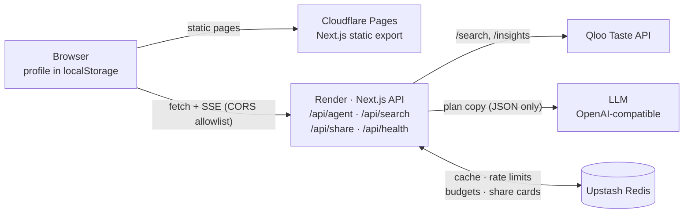
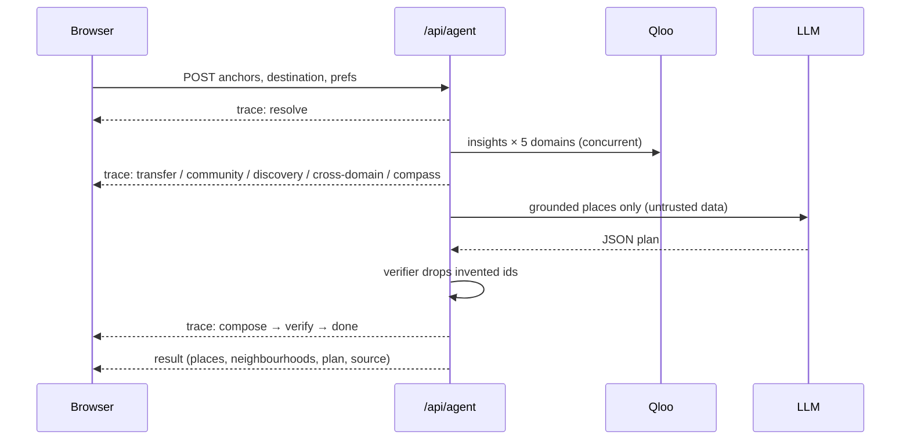

<p align="center">
  
</p>

<h1 align="center">Hearth</h1>

<p align="center">
  <b>Rebuild your cultural home in any city.</b><br />
  A taste-transfer agent powered by the Qloo Taste Graph.
</p>

<p align="center">
  <a href="https://qloo-product.pages.dev"><b>▶ Try the live app</b></a> ·
  <a href="https://qloo-product.onrender.com/api/health">API health</a>
</p>

<h3 align="center">DEMO VIDEO</h3>

<p align="center">
  <a href="https://youtu.be/JSKGUbFVmv4">
    
  </a>
  <br />
  <a href="https://youtu.be/JSKGUbFVmv4"><b>▶ Watch on YouTube: https://youtu.be/JSKGUbFVmv4</b></a>
</p>

<p align="center">
  <a href="https://github.com/opeblow/HEARTH/actions/workflows/ci.yml"></a>
  <a href="https://github.com/opeblow/HEARTH/actions/workflows/codeql.yml"></a>
  <a href="./LICENSE"></a>
  = 22.13" />
  
  
  
</p>

---

<p align="center">
  <a href="https://qloo-product.pages.dev"></a>
</p>

---

## For judges

### Try it in 60 seconds

1. Open **[qloo-product.pages.dev](https://qloo-product.pages.dev)**.
2. Click **Start with a demo persona**. This is Adaeze, an MSc student moving from Lagos to Toronto.
3. Her favourites are matched to real Qloo entities and the agent runs **live**. Watch each step stream in.
4. On the results page, open **View trace** to see every Qloo call and how many ungrounded picks were removed.
5. Click **See the 30-day plan**, then **Export to calendar** to download it as an `.ics` file.
6. Try **Blend** (shared taste for two) and **Proof** (Hearth vs. an LLM-only answer).

Backend status: [`/api/health`](https://qloo-product.onrender.com/api/health) reports live Qloo, AI model and Redis status. The first request after the backend has been idle can take up to a minute while Render wakes it up.

### Judging scorecard

| Criterion | How Hearth delivers | Where to see it |
| --- | --- | --- |
| **Use of the Qloo Taste API** | Qloo is the source of truth for every result, not a side feature. Free-text favourites are resolved to Qloo entity ids (`/search`), then replayed against the destination city through `/insights` across **five concurrent domains**: Comfort, Community, Discovery, a cross-domain sweep (artists, films, brands), and neighbourhoods built from real Qloo `neighborhood` data. Affinity scores are shown in the UI. | [How we use Qloo](#how-we-use-qloo) · `src/lib/qloo/` · results page |
| **Intelligent use of LLMs** | The AI model does what it is good at (writing the reasons and the week-by-week plan) and nothing it is bad at (inventing places). It receives only this run's Qloo data, labelled as untrusted, and must return schema-checked JSON. A verifier drops any id it invented, and any week it leaves empty falls back to a plan built without the AI. Prompt-injection attempts in user input are filtered. | [The grounding contract](#the-grounding-contract) · `src/lib/agent/` · `/proof` |
| **Technical implementation** | Next.js 16 + React 19 + strict TypeScript. A streamed agent pipeline (Server-Sent Events) with concurrent fan-out, request coalescing, a 24 h Redis cache, retries with backoff, timeouts and daily budgets. Zod validation at every boundary. 48 tests, CI on Node 22 and 24, CodeQL scanning. Deployed as a Cloudflare Pages frontend plus a Render API. | [Architecture](#architecture) · [Testing](#testing) · [Deployment](#deployment) |
| **Originality & creativity** | Relocation tools handle rent and commute. Hearth answers *"where do I go to feel like myself again?"* Its ideas are its own: taste transfer between cities, the ordered Comfort → Community → Discovery landing, a familiarity dial, Blend for two people, and a 30-day soft-landing plan. | [Features](#features) · landing page |
| **Real-world impact** | Built for students, expats, migrants and people returning home, in cities the usual tools ignore (Lagos, Accra, Seoul, Toronto, Berlin). No account and no email; profiles stay on the device. It is a working product today, with security and spending limits suitable for the public internet. | [Personas](#demo-personas) · [Data & privacy](#data--privacy) |
| **Presentation & documentation** | A live deployment, a demo video, a one-click persona flow, an inspectable agent trace, and this README. | [Demo video](https://youtu.be/JSKGUbFVmv4) · this document |

---

## Table of contents

- [For judges](#for-judges)
- [Overview](#overview)
- [Why Hearth](#why-hearth)
- [Features](#features)
- [Demo personas](#demo-personas)
- [Pages](#pages)
- [How it works](#how-it-works)
- [Architecture](#architecture)
- [How we use Qloo](#how-we-use-qloo)
- [The grounding contract](#the-grounding-contract)
- [Tech stack](#tech-stack)
- [Quick start](#quick-start)
- [Environment variables](#environment-variables)
- [Scripts](#scripts)
- [Project structure](#project-structure)
- [API reference](#api-reference)
- [Performance](#performance)
- [Data & privacy](#data--privacy)
- [Testing](#testing)
- [Deployment](#deployment)
- [Security](#security)
- [Accessibility](#accessibility)
- [Troubleshooting](#troubleshooting)
- [FAQ](#faq)
- [Roadmap](#roadmap)
- [Contributing](#contributing)
- [License](#license)

---

## Overview

Hearth is a full-stack taste-transfer agent. You tell it the places, music, food
and films that made your old city feel like home; it finds their true equivalents
in the city you're moving to, then turns them into a 30-day soft-landing plan
grouped into **Comfort**, **Community** and **Discovery**.

It is built on the [Qloo Taste API](https://www.qloo.com) and is deliberately
obsessive about one thing: **it never invents a place.** Every recommendation is
grounded in a real Qloo entity returned by the current run, and a deterministic
verifier drops anything the model can't trace back.

One codebase ships both the product and its backend: Next.js App Router pages
for the frontend, route handlers (`/api/*`) for the agent, search, sharing and
health. It runs as a single Node app, or split: the live deployment serves a
static frontend from **Cloudflare Pages** and the API from **Render**.

## Why Hearth

Relocation tools optimise for logistics — rent, schools, commute. None of them
answer the question that actually decides whether a move feels survivable:
*where do I go to feel like myself again?*

LLM-only answers hallucinate venues that don't exist and default to a US/EU
canon. Hearth answers with real, taste-graph-grounded places — in cities the
usual tools ignore (Lagos, Accra, Seoul, Lisbon, Berlin, Toronto) — and shows
its work at every step.

## Features

- **Taste intake** — search and resolve real anchors (a bar, an artist, a film,
  a dish, a brand) against the Qloo entity graph, then dial familiarity and
  preferences per category.
- **Cross-city transfer** — the same signal is replayed with your destination as
  the location filter across three buckets: Comfort, Community, Discovery.
- **Grounded agent run** — a streamed, typed agent loop fans out across five
  Qloo domains concurrently and emits a live trace you can watch in the UI.
- **30-day soft-landing plan** — a week-by-week plan (four weeks) that moves
  from Comfort to Community to Discovery, exportable as an `.ics` calendar file
  generated entirely on your device.
- **Taste Bridge** — a side-by-side comparison of your origin city's scene and
  its destination-city equivalents.
- **Blend** — merge two people's taste profiles into one shared plan (roommates,
  couples, friends moving together).
- **Share cards** — publish an anonymous, revocable result card at `/s/[id]`
  with a one-time delete token. No account, ever.
- **Honest sourcing** — every result is labelled `live`, `cached` or `demo`, so
  users always know whether they're seeing real Qloo data or the recorded
  development fixtures.
- **Privacy by design** — profiles live in your browser's `localStorage`;
  nothing about you is stored server-side.
- **Strict security posture** — CSP, HSTS, COOP/CORP, locked-down
  `Permissions-Policy`, per-IP rate limiting and daily API budgets.

## Demo personas

One click on a persona fills in the intake and starts a live run.

| Persona | Move | Favourites | Profile |
| --- | --- | --- | --- |
| **Adaeze** | Lagos → Toronto | Terra Kulture, Freedom Park Lagos, Nike Art Gallery, Lagos Island, Suya | MSc student; music and food first. Lively, low budget, solo. |
| **Ji-woo** | Seoul → Berlin | Hongdae, Euljiro, Seongsu-dong, Gwangjang Market | Product designer moving for a studio job. Balanced, mid budget, solo. |
| **Kwame** | London → Accra | +233 Jazz Bar & Grill, Nubuke Foundation, Jamestown, Makola Market | Returning home after a decade away. Balanced, mid budget, couple. |

Defined in `src/lib/personas.ts`.

## Pages

| Route | What it does |
| --- | --- |
| `/` | Landing page: the story, how it works, personas. |
| `/start` | Intake: search favourites, set origin/destination, familiarity dial and preferences, then run the agent. |
| `/bridge` | Results: Taste Bridge, Comfort / Community / Discovery cards, neighbourhood compass, agent trace. |
| `/plan` | The 30-day soft-landing plan, with `.ics` export. |
| `/blend` | Blend two people's taste and publish a shareable card. |
| `/s/[id]` | A shared card (server-rendered; on Cloudflare it is rewritten to `/card`). |
| `/proof` | How Hearth compares to an LLM-only baseline, and how grounding works. |
| `/privacy` | What stays on your device and what leaves it. |

## How it works

1. **Intake** — your anchors are resolved to real Qloo entities: a bar, an
   artist, a film, a dish, a brand.
2. **Transfer** — the same signal is replayed with your destination as the
   location filter, across three buckets:
   - **Comfort** — places that feel like the ones you left behind.
   - **Community** — where people who share your taste already gather.
   - **Discovery** — adjacent, fresh picks, with your comfort results excluded.
3. **Verify** — every candidate is checked against this run's Qloo results.
   Ungrounded items are dropped and counted.
4. **Compose** — a 30-day plan is assembled and ordered to cut travel.

The whole loop streams back to the browser as a typed SSE trace, so you watch it
resolve anchors, fan out across the taste graph, rank neighbourhoods and write
the plan — in real time, not after a spinner.

## Architecture



### One agent run



| Layer | Responsibility | Key files |
| --- | --- | --- |
| UI | Pages, streaming run console, results, plan, blend | `src/app/*`, `src/components/hearth/*` |
| Agent | Orchestration, fan-out, verification, plan composition | `src/lib/agent/run.ts`, `verifier.ts`, `planner.ts`, `prompts.ts`, `llm.ts` |
| Qloo | Client, retries, cache, coalescing, schemas, fixtures | `src/lib/qloo/*` |
| Security | Env validation, CORS, rate limit, input sanitising | `src/lib/security/*` |
| Client API base | Same-origin or split-hosting API URL | `src/lib/api.ts` |

## How we use Qloo

Hearth talks to the [Qloo Taste API](https://www.qloo.com) through a single
server-only choke point (`src/lib/qloo/client.ts`). The browser never sees the
Qloo key and never calls Qloo directly.

### Endpoints used

| Qloo endpoint | Purpose in Hearth |
| --- | --- |
| `GET /v2/search` | Resolve free-text anchors ("Dishoom", "Fela Kuti", "In the Mood for Love") to canonical entity ids. Also powers the live anchor search box and the health probe. |
| `POST /v2/insights` | The core transfer primitive. Given anchor entity ids + a destination location filter, Qloo returns ranked entities with affinity scores — this powers the Comfort, Community and Discovery buckets, the cross-domain artist/movie/brand sweep, and neighbourhood grounding. |

### The signal model

- **Anchors are entities, not strings.** Free text is resolved via `/search` to
  Qloo entity ids (`urn:entity:…`). Every downstream call passes those ids as
  the `signal.interests.entities` payload — taste in, taste out.
- **Destination as a filter, not a query.** Each `/insights` call sets
  `filter.location.query` to the destination city, so the graph answers "what
  matches this taste *there*", never a generic global list.
- **Three buckets, one wave.** Comfort, Community and Discovery are three
  `/insights` calls with different signal shaping (anchor-anchored,
  affinity-weighted, and exclusion-filtered respectively). All five domains of
  a run — the three buckets plus cross-domain and neighbourhoods — fan out
  **concurrently**; discovery's "don't repeat comfort/community" rule is applied
  as a local post-filter, not a second serial round trip.
- **Cross-domain sweep.** A parallel fan-out across `artist`, `movie` and
  `brand` types surfaces adjacent culture (the film soundtracks, the brands your
  anchors' audience also loves) filtered to the destination.
- **Real neighbourhoods only.** Neighbourhood rankings are grouped from the
  genuine `properties.neighborhood` values Qloo returns for grounded places —
  no hardcoded district lists, ever.
- **Affinity is legible.** Qloo's affinity scores are normalised to `0..1` and
  surfaced in the UI, so users can see *why* a place ranked.

### Reliability engineering around the API

| Concern | Implementation |
| --- | --- |
| **Validation** | Every Qloo response is parsed with Zod schemas (`src/lib/qloo/schemas.ts`) before it touches app code. A malformed upstream payload fails the domain, never the process. |
| **Timeouts** | Per-request `AbortController` deadline (`QLOO_TIMEOUT_MS`, default 6500 ms). |
| **Retries** | Up to 4 attempts with jittered exponential backoff on 5xx and network errors; `Retry-After` is honoured on 429s. |
| **Caching** | Every response cached 24 h by kind (`search`, `insights`, `cross`, `hoods`) in Upstash Redis (production) or an in-process store (development). Cache hits are labelled `source: "cached"`. |
| **Coalescing** | Concurrent identical requests share one network round trip via an in-flight map — the agent's fan-out can't stampede the same query. |
| **Budgets** | Hard daily caps on Qloo calls (`DAILY_QLOO_BUDGET`) and LLM calls (`DAILY_LLM_BUDGET`), enforced in Redis so they survive deploys. |
| **Health** | `GET /api/health` runs a tiny, short-cached liveness probe (`/search?query=coffee&take=1`) so uptime monitors don't burn budget. |
| **Honest fallback** | With no `QLOO_API_KEY`, a recorded fixture engine serves deterministic demo data labelled `source: "demo"` in the UI. Production boot **refuses** to run in fixture mode. |

## The grounding contract

- The LLM writes *reasons* and the *plan narrative*. It never invents a venue.
- The model may only reference entity ids that appear in the current run's Qloo
  responses. A deterministic verifier (`src/lib/agent/verifier.ts`) enforces
  this; rejected items are counted and surfaced on `/proof`, never shown.
- If no LLM key is configured, Hearth falls back to the deterministic composer —
  the product still works end to end, fully grounded.
- If no Qloo key is configured, Hearth serves a **recorded fixture engine** and
  labels every result `source: "demo"`. It is honest about it, never fake-live.

## Tech stack

| Layer | Choice |
| --- | --- |
| Framework | Next.js 16 (App Router, React 19, Turbopack) |
| Language | TypeScript (strict), Zod at every boundary |
| Styling | Tailwind CSS v4, token-driven warm-cinematic design system |
| Motion | `motion`, custom Aceternity/MagicUI primitives |
| Data | Qloo Taste API; optional Upstash Redis (cache, rate limits, budgets, share cards) |
| LLM | Any OpenAI-compatible chat-completions endpoint (optional) |
| Testing | Vitest + Testing Library (jsdom) |
| CI | GitHub Actions (typecheck, lint, test, build × Node 22/24) + CodeQL |
| Package manager | pnpm 11 |

## Quick start

Requires **Node >= 22.13** and **pnpm 11**.

```bash
git clone https://github.com/opeblow/HEARTH.git
cd HEARTH
pnpm install
cp .env.example .env.local   # optional: add keys, or just run the demo
pnpm dev
```

Open http://localhost:3000. With no keys, Hearth runs entirely on the fixture
engine — every page works, zero setup.

To run live, set `QLOO_API_KEY` (and optionally an LLM key) in `.env.local`.

## Environment variables

Everything except `NEXT_PUBLIC_*` is **server-side only** (see `.env.example`). The Qloo and LLM
keys are never prefixed `NEXT_PUBLIC_` and never reach the browser. Blank values
are treated as unset, so hosts that inject empty vars are safe.

| Variable | Default | Purpose |
| --- | --- | --- |
| `NEXT_PUBLIC_SITE_URL` | `https://hearth.app` | Public site URL for metadata / Open Graph. |
| `NEXT_PUBLIC_API_BASE_URL` | — (same origin) | **Frontend build only.** Backend URL for split hosting, e.g. `https://qloo-product.onrender.com`. |
| `CORS_ALLOW_ORIGINS` | — (same origin only) | **Backend only.** Comma-separated frontend origins allowed to call `/api/*`, e.g. `https://qloo-product.pages.dev`. |
| `QLOO_API_KEY` | — | Qloo Taste API key. Absent → fixtures mode. |
| `QLOO_BASE_URL` | `https://hackathon.api.qloo.com/v2` | Qloo API base URL. |
| `QLOO_MODE` | `auto` | `auto` \| `live` \| `fixtures`. `auto` = live when a key exists. |
| `QLOO_TIMEOUT_MS` | `6500` | Per-request Qloo timeout. Lower = snappier, riskier. |
| `LLM_API_KEY` | — | Any OpenAI-compatible key. Absent → deterministic composer. |
| `LLM_BASE_URL` | `https://api.openai.com/v1` | OpenAI-compatible base URL. |
| `LLM_MODEL` | `gpt-4o-mini` | Model used for the plan narrative. |
| `UPSTASH_REDIS_REST_URL` | — | Optional. Unset → in-process cache + limiter. |
| `UPSTASH_REDIS_REST_TOKEN` | — | Optional Upstash token. |
| `RATE_LIMIT_PER_MINUTE` | `12` | Per-IP request budget. |
| `DAILY_QLOO_BUDGET` | `4000` | Hard stop for Qloo calls per day. |
| `DAILY_LLM_BUDGET` | `2000` | Hard stop for LLM calls per day. |

**Production boot is strict** (`src/lib/security/env.ts`): the app refuses to
start in `NODE_ENV=production` unless `QLOO_API_KEY` and both Upstash variables
are set, and it throws if `QLOO_MODE=fixtures` is requested. Mock data can never
be served to production users.

## Scripts

| Script | What it does |
| --- | --- |
| `pnpm dev` | Start the dev server (Turbopack). |
| `pnpm build` | Production build (single Node app, or the Render backend). |
| `pnpm build:static` | Static export to `out/` for Cloudflare Pages (`scripts/static-export.mjs`). |
| `pnpm start` | Serve the production build. |
| `pnpm typecheck` | `tsc --noEmit`. |
| `pnpm lint` | ESLint (flat config). |
| `pnpm test` | Vitest, single run. |
| `pnpm test:watch` | Vitest in watch mode. |
| `pnpm verify` | Type check + lint + tests — the same gate CI runs. |

## Project structure

```
HEARTH/
├── .github/
│   ├── workflows/
│   │   ├── ci.yml                     CI: typecheck, lint, test, build (Node 22 + 24)
│   │   └── codeql.yml                 CodeQL security scanning
│   ├── dependabot.yml                 Dependency update automation
│   └── PULL_REQUEST_TEMPLATE.md
├── docs/
│   └── landing.jpg                    Landing page screenshot
├── public/
│   ├── _headers                       Cloudflare Pages security headers (CSP allows the API origin)
│   └── _redirects                     Cloudflare Pages rewrite: /s/:id → /card
├── scripts/
│   └── static-export.mjs              Static build for Cloudflare (sets server routes aside)
├── src/
│   ├── app/                           Next.js App Router
│   │   ├── layout.tsx                 Root layout: fonts, theme, nav
│   │   ├── page.tsx                   Landing page
│   │   ├── icon.svg                   Favicon (served automatically by Next.js)
│   │   ├── globals.css                Design tokens and global styles
│   │   ├── error.tsx                  Client error boundary
│   │   ├── not-found.tsx              Custom 404
│   │   ├── start/                     Intake: anchors + preferences
│   │   ├── bridge/                    The taste transfer (streamed run)
│   │   ├── plan/                      30-day soft-landing plan
│   │   ├── blend/                     Blend two people's taste
│   │   ├── proof/                     Hearth vs an LLM-only baseline
│   │   ├── privacy/                   What stays on your device
│   │   ├── s/[id]/                    Shared result card (server-rendered)
│   │   ├── card/                      Shared result card (client-side, for static hosting)
│   │   └── api/
│   │       ├── agent/route.ts         POST: SSE agent run (+ route.test.ts)
│   │       ├── search/route.ts        GET: anchor search
│   │       ├── share/route.ts         Create / read / revoke share cards
│   │       └── health/route.ts        GET: config + readiness report
│   ├── components/
│   │   ├── hearth/                    Product components (nav, cards, console, ...)
│   │   ├── aceternity/                Motion/layout primitives (bento, spotlight, ...)
│   │   ├── magicui/                   Animation primitives (marquee, beams, ...)
│   │   └── ui/                        Design-system primitives (button, dialog, ...)
│   ├── lib/
│   │   ├── agent/                     run loop, verifier, planner, prompts, llm, events
│   │   ├── qloo/                      client, cache, queries, schemas, fixtures, engine
│   │   ├── security/                  env validation, CORS, sanitize, ratelimit
│   │   ├── api.ts                     API base URL for split hosting
│   │   ├── domain.ts                  Core domain types
│   │   ├── share.ts                   Share-card data helpers
│   │   ├── ics.ts                     ICS calendar generation
│   │   ├── personas.ts                Taste persona presets
│   │   ├── store.ts                   Client preference store
│   │   └── utils.ts                   Shared utilities
│   ├── instrumentation.ts             Server instrumentation hook
│   └── test/stubs/server-only.ts      Test stub for the server-only marker
├── .env.example                       Environment variable documentation
├── .gitignore                         Ignores secrets, node_modules, production/
├── .nvmrc                             Pinned Node version
├── next.config.ts                     Security headers (CSP/HSTS) + build config
├── package.json                       Scripts and dependencies
├── pnpm-lock.yaml                     Locked dependency tree
├── pnpm-workspace.yaml                pnpm workspace/build configuration
├── postcss.config.mjs                 Tailwind CSS via PostCSS
├── tsconfig.json                      Strict TypeScript config
├── vitest.config.ts                   Vitest test environment
├── eslint.config.mjs                  ESLint flat config
├── README.md  SECURITY.md  CONTRIBUTING.md  CODE_OF_CONDUCT.md  LICENSE
```

## API reference

All mutating routes are rate-limited per IP (`RATE_LIMIT_PER_MINUTE`) and
guarded by daily budgets. Requests are Zod-validated and shape-checked before
any upstream call. Obvious prompt-injection payloads in search queries are
refused and never echoed.

### `POST /api/agent`

Runs the agent. Responds with `text/event-stream` of typed trace events,
ending in a `result` event.

```bash
curl -N -X POST https://your-host/api/agent \
  -H "content-type: application/json" \
  -d '{
    "anchors": [{ "id": "<qloo-entity-id>", "name": "Dishoom", "type": "place", "tags": [] }],
    "origin": "London",
    "destination": "Lisbon",
    "prefs": {
      "familiarity": 0.5, "vibe": "balanced", "budget": "mid",
      "dietary": [], "accessibility": [], "who": "solo"
    }
  }'
```

| Field | Rules |
| --- | --- |
| `anchors` | 1–10 items. `type` is one of `place`, `artist`, `film`, `tv`, `dining`, `brand`, `book`, `podcast`. Up to 20 `tags`. |
| `origin` | Optional, up to 60 characters. |
| `destination` | Required, up to 60 characters. |
| `prefs.familiarity` | `0` (home) to `1` (surprise me). |
| `prefs.vibe` / `budget` / `who` | `quiet`, `balanced`, `lively` · `low`, `mid`, `high` · `solo`, `couple`, `group`. |

Unknown fields are rejected. The stream sends three message types: `trace`,
`result` and `error`. Trace events carry a `kind` in run order: `resolve` →
`transfer` · `community` · `discovery` · `cross-domain` · `compass` (concurrent)
→ `compose` → `verify` → `done`, each with a status and Qloo call counts. The
final `result` holds places, neighbourhoods, the plan, the source label and the
number of picks the verifier rejected.

All routes answer CORS preflight (`OPTIONS`) and add CORS headers only for
origins listed in `CORS_ALLOW_ORIGINS`.

### `GET /api/search?q=`

Resolves an anchor query to Qloo entities (max 6, cached 24 h).

```bash
curl "https://your-host/api/search?q=Fela%20Kuti"
```

### `/api/share`

| Method | Body | Returns |
| --- | --- | --- |
| `POST` | `{ title, destination, picks[] }` (1–8 picks) | `{ id, deleteToken, url }` — `deleteToken` is shown once; it is the only way to revoke. |
| `GET ?id=` | — | The public card payload (`no-store`, `noindex`). |
| `DELETE` | `{ id, deleteToken }` | `{ deleted: true }` or `403`. |

### `GET /api/health`

Dependency status without leaking secrets:

```json
{
  "status": "ok",
  "qloo": { "mode": "live", "reachable": true, "status": 200 },
  "llm": { "configured": true },
  "redis": { "configured": true, "healthy": true },
  "time": "2026-10-17T12:00:00.000Z"
}
```

`status` is `degraded` when Qloo is unreachable or a configured Redis fails.

## Performance

Hearth is built to feel instant, and the agent pipeline is engineered for it:

- **One wave, not five.** The five Qloo domains (comfort, community, discovery,
  cross-domain, neighbourhoods) are independent. They all fan out **concurrently**
  and each result streams to the UI the instant it lands, instead of blocking on
  the slowest call. (`src/lib/agent/run.ts`)
- **No serial exclusion round trip.** Discovery is post-filtered locally against
  comfort/community ids rather than paying a second sequential query — same
  guarantee, one fewer round trip.
- **In-flight coalescing.** Concurrent identical Qloo requests share a single
  network call (`src/lib/qloo/client.ts`).
- **Two-layer cache.** Every Qloo response is cached (24h) in Upstash Redis when
  configured, or an in-process store otherwise. Cache hits return `source: "cached"`.
- **Bounded latency.** Configurable per-request timeout (`QLOO_TIMEOUT_MS`) and
  capped retries with jittered backoff, so a slow upstream degrades instead of hanging.
- **Streamed over SSE.** The client renders trace events as they arrive; time to
  first meaningful paint is not gated on the full run.
- **Tree-shaken imports.** `optimizePackageImports` trims icon/motion/util barrels
  for smaller client bundles.
- **Static where possible.** Marketing and content pages prerender as static;
  only the agent, share, search and health routes are dynamic.

## Data & privacy

- Profiles, anchors and preferences live in the browser's `localStorage` —
  there is no user table and no personal data store.
- Share cards contain only the curated picks the user chose to publish, are
  unindexed (`X-Robots-Tag: noindex`), and are revocable at any time with the
  one-time delete token.
- Server logs never include API keys or request bodies; errors detail
  server-side only and are never echoed to clients.
- The `/privacy` page explains all of this to end users in plain language.

## Testing

```bash
pnpm test        # 48 tests across agent, qloo, security, API, CORS and utils
pnpm verify      # typecheck + lint + tests (what CI enforces)
```

Coverage includes the agent control flow (fan-out, discovery post-filter,
grounding), the streaming `/api/agent` route, CORS preflight on every API route,
the verifier, the planner, query builders, the fixture engine, and input
sanitisation. The `server-only` marker is stubbed for
tests via `vitest.config.ts` so server modules can be imported directly.

CI runs the full gate on Node 22 and 24, then performs a production build in
fixture mode — the build must succeed with zero secrets.

## Deployment

Hearth runs as one Node app, or split across two hosts. The live demo is split:

| Part | Host | URL |
| --- | --- | --- |
| Frontend (static) | Cloudflare Pages | https://qloo-product.pages.dev |
| Backend API | Render (Node web service) | https://qloo-product.onrender.com |

### Backend on Render

| Setting | Value |
| --- | --- |
| Build command | `corepack enable && pnpm install --frozen-lockfile && pnpm build` |
| Start command | `pnpm start` (listens on Render's `PORT`) |
| Health check path | `/api/health` |
| Node version | from `.nvmrc` (22) |
| Environment | `QLOO_API_KEY`, `QLOO_BASE_URL`, `LLM_API_KEY`, `LLM_BASE_URL`, `LLM_MODEL`, `UPSTASH_REDIS_REST_URL`, `UPSTASH_REDIS_REST_TOKEN`, `CORS_ALLOW_ORIGINS=https://<your-pages-domain>` |

### Frontend on Cloudflare Pages

| Setting | Value |
| --- | --- |
| Build command | `pnpm build:static` |
| Output directory | `out` |
| Environment | `NEXT_PUBLIC_API_BASE_URL=https://<your-render-domain>`, `NEXT_PUBLIC_SITE_URL=https://<your-pages-domain>`, `NODE_VERSION=22` |

Also update `connect-src` in `public/_headers` to your Render URL, or the
browser will block API calls. `public/_redirects` rewrites `/s/:id` to the
client-side `/card` page, which fetches the card from the API.

**Deploy order:** deploy the backend first and copy its URL. Then deploy the
frontend with that URL, and finally add the frontend URL to
`CORS_ALLOW_ORIGINS` on the backend and redeploy it.

### Single Node host

```bash
pnpm install --frozen-lockfile
pnpm build
pnpm start       # serves pages and API on PORT (default 3000)
```

Works on Render, Fly.io, Railway, Vercel or a container. No CORS setup is needed.

### Production checklist

- [ ] `QLOO_API_KEY` set (live key)
- [ ] `QLOO_MODE=live` (fixtures are refused at boot anyway)
- [ ] `UPSTASH_REDIS_REST_URL` + `UPSTASH_REDIS_REST_TOKEN` set (cache, rate
      limits, daily budgets and share cards all live here)
- [ ] `NEXT_PUBLIC_SITE_URL` set to the canonical public URL (drives OG/meta)
- [ ] Optional: `LLM_API_KEY` + `LLM_MODEL` for narrative planning
- [ ] Split hosting: `CORS_ALLOW_ORIGINS` (backend), `NEXT_PUBLIC_API_BASE_URL` (frontend build), and `connect-src` in `public/_headers` all point at each other
- [ ] `GET /api/health` returns `"status": "ok"` after deploy
- [ ] Rate-limit and budget values sized for your traffic

## Security

See [SECURITY.md](./SECURITY.md). Highlights:

| Control | Detail |
| --- | --- |
| Content-Security-Policy | Locked to `'self'`; no third-party script/style origins. |
| HSTS | 2 years, `includeSubDomains`, `preload`. |
| Frame protection | `frame-ancestors 'none'` + `X-Frame-Options: DENY`. |
| MIME sniffing | `X-Content-Type-Options: nosniff`. |
| Referrer | `strict-origin-when-cross-origin`. |
| COOP / CORP | `same-origin` for both. |
| Permissions-Policy | Camera, microphone, geolocation, payment, sensors all denied. |
| API hygiene | `no-store` + `noindex` on all `/api/*`; per-IP rate limits; daily budgets. |
| CORS | Exact-origin allowlist (`CORS_ALLOW_ORIGINS`); other origins get no CORS headers. |
| LLM safety | Model output is schema-validated JSON; invented entity ids are dropped; Qloo data is passed to the model labelled as untrusted. |
| Input handling | Zod validation at every boundary; prompt-injection payloads refused. |
| Secrets | Server-only, validated at boot, never `NEXT_PUBLIC_`, never logged. |

## Accessibility

- Skip-to-content link, semantic landmarks (`header`/`main`/`footer`/`nav`).
- All interactive controls are keyboard-operable with visible focus states.
- The mobile menu dialog is an accessible dialog (`aria-expanded`,
  `aria-label`, focus-managed).
- Theme respects `prefers-color-scheme`; motion respects
  `prefers-reduced-motion`.
- Colour pairs meet WCAG AA contrast in both themes.

## Troubleshooting

| Symptom | Fix |
| --- | --- |
| CI fails at `pnpm store path` | Ensure `pnpm-workspace.yaml` declares `packages: ["."]` and CI uses pnpm 11. |
| `Production requires: QLOO_API_KEY` at boot | Set the Qloo + Upstash env vars on the host — this is the strict production guard working as intended. |
| Everything shows `demo` labels | No `QLOO_API_KEY` is visible to the server; check the host's env (not `.env.local`) and `QLOO_MODE`. |
| 429s from the API | Per-IP limit or daily budget hit; raise `RATE_LIMIT_PER_MINUTE` / `DAILY_QLOO_BUDGET` or wait for the window to reset. |
| Slow first run | Cold Upstash + empty cache; subsequent identical runs hit the 24 h cache. |
| First request takes ~1 minute | Render has put an idle backend to sleep; it wakes on the first request. |
| Browser console: CORS error | Add the exact frontend origin (no trailing slash) to `CORS_ALLOW_ORIGINS` on the backend and redeploy. |
| Browser console: blocked by CSP `connect-src` | Put your backend URL in `public/_headers` and redeploy the frontend. |
| Shared `/s/<id>` link says "Card not found" on Cloudflare | Check `public/_redirects` is in `out/` and the card id is valid; cards can be revoked. |
| CI: "Multiple versions of pnpm specified" | Keep the pnpm version only in `package.json` (`packageManager`), not in the workflow. |

## FAQ

**Does Hearth ever make up a place?**
No. Every place comes from a Qloo response in the current run. The AI model writes descriptions only, and the verifier removes any id it did not get from Qloo.

**What happens without an AI model key?**
Hearth uses its own rule-based composer to build the plan. Everything still works and stays grounded.

**What happens without a Qloo key?**
In development, Hearth serves recorded demo data labelled `demo`. In production it refuses to start.

**Do I need an account?**
No. Your profile stays in your browser. Only the favourites you search for and the run inputs are sent to the API.

**Which cities work?**
Any city Qloo has data for. The personas show Toronto, Berlin and Accra.

## Roadmap

- [ ] PWA install + offline intake
- [ ] Multi-city itineraries ("two weeks in Lisbon, then Berlin")
- [ ] Email delivery of the 30-day plan
- [ ] Public share-card images (OG image generation)
- [ ] Community taste blends (share a blend link with friends)

## Contributing

See [CONTRIBUTING.md](./CONTRIBUTING.md) and the
[Code of Conduct](./CODE_OF_CONDUCT.md). The short version: run `pnpm verify`
before opening a PR, and keep every recommendation grounded.

## License

[MIT](./LICENSE) © Hearth contributors.
